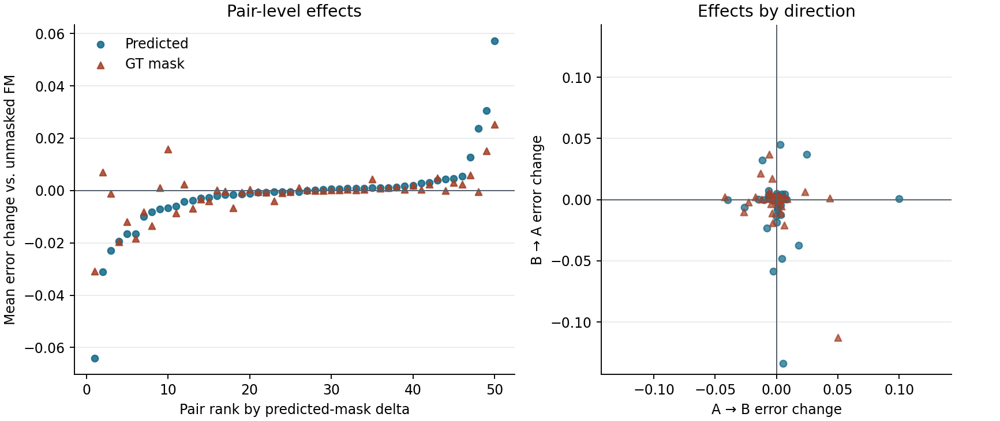

# Day 01 — EchoMatch overlap weighting on PARTIALSMAL

**21 November 2026 · Published DINO checkpoint · Official PARTIALSMAL test**

## Why start with inference?

EchoMatch already predicts which vertices belong to the shared region of two partial shapes. In the baseline, overlap BCE supervises those predictions. During training, the functional-map (FM) solver instead receives the GT mask on Y. At test time the baseline FM solver receives unmasked descriptors. This leaves an open question about the model's existing overlap predictions. Can they help the solver focus on descriptors from the shared region?

Day 01 is a first test of that idea before using predicted overlap in training. We freeze the published DINO checkpoint, score the same test correspondences, and change only the weights on Y's descriptors before fitting the FM. The unmasked FM is the reference, the GT mask is a diagnostic for supplying known overlap support, and direct descriptor nearest neighbors give a separate reference for the existing representation. This setup isolates what the solver does with today's predictions. Training through those weights would ask whether correspondence supervision can improve the predictor, the descriptors, or both. [Baseline training path](https://github.com/xieyizheng/DeepShapeMatchingKit/blob/15d14bbc957bd06e355e78c9b2b4bd955d0c2eeb/models/echo_match_model.py#L72) · [Inference variants](https://github.com/angelhiguera/DeepShapeMatchingKit/blob/4816bdd944632dd6dea4836e3d0268d6e21606c3/models/echo_match_model.py#L188)

## Code and dataset

The code comparison uses three pinned revisions. The experiment snapshot contains the CSV exports. The exact working tree and effective YAML used by Marvin job `29240854` remain unverified.

| Revision | Verified scope |
| --- | --- |
| [Upstream `15d14bb`](https://github.com/xieyizheng/DeepShapeMatchingKit/commit/15d14bbc957bd06e355e78c9b2b4bd955d0c2eeb) | Published DINO evaluation config and checkpoint, PARTIALSMAL dataset, Diff3F feature loading, EchoMatch training, unmasked FM and direct descriptor NN at evaluation. |
| [Fork `master` at `b1505af`](https://github.com/angelhiguera/DeepShapeMatchingKit/commit/b1505af1708965941de7b604138d3c0ac7061116) | Adds the portable research split generator, the Marvin XYZ baseline launcher, the configurable evaluation worker count and the opt-in GT mask at evaluation. |
| [Experiment snapshot `4816bdd`](https://github.com/angelhiguera/DeepShapeMatchingKit/tree/4816bdd944632dd6dea4836e3d0268d6e21606c3) | Adds soft and optional binary weighting, an explicit checkpoint check for configured runs, directional and unordered-pair CSV exports, targeted vertex diagnostics and Marvin launchers. The DINO base YAML, feature extraction, FM solver and loss definitions match upstream. [Diff from fork master](https://github.com/angelhiguera/DeepShapeMatchingKit/compare/b1505af1708965941de7b604138d3c0ac7061116...4816bdd944632dd6dea4836e3d0268d6e21606c3) |

The CSVs contain **100 directed maps** for **50 unordered pairs** and **89 distinct mesh names**. This is the official test protocol at `../data/PARTIALSMAL/test`. Each pair contributes both directions. The separate seed-1234 research split comes from the official **training** set and holds out 16 of its 152 unordered pairs. That split is pair-disjoint and can share shapes across train and validation. It belongs to the local XYZ control and future training comparisons. The published DINO checkpoint was evaluated directly on the official test set here. [PARTIALSMAL dataset loader](https://github.com/xieyizheng/DeepShapeMatchingKit/blob/15d14bbc957bd06e355e78c9b2b4bd955d0c2eeb/datasets/shape_dataset.py#L743) · [Split generator](https://github.com/angelhiguera/DeepShapeMatchingKit/blob/b1505af1708965941de7b604138d3c0ac7061116/scripts/create_partialsmal_split.py)

The published config uses 768-dimensional DINOv2 ViT-B/14 descriptors lifted from 100 rendered views per mesh. DiffusionNet outputs 128-dimensional descriptors. The code keeps 128 spectral modes in the diffusion operators and uses 50 for the functional map. The original DINO YAML has seed 1234, `return_dino: true` and a weights-only checkpoint load. The Git-tracked `checkpoints/echo_match/echo_match_psmal_dino.pth` has SHA-256 `acbe75fd2091980fb9628f4458b118287af5639e11f05023c1af42a69849fe59`. That identifies the repository copy. A hash from the running job would confirm its local copy. The Torch Hub DINOv2 revision is unpinned in this snapshot, which matters if the feature cache is regenerated. [Published config](https://github.com/xieyizheng/DeepShapeMatchingKit/blob/15d14bbc957bd06e355e78c9b2b4bd955d0c2eeb/options/echo_match/test/echo_match_psmal_dino.yaml) · [DINO extraction](https://github.com/xieyizheng/DeepShapeMatchingKit/blob/15d14bbc957bd06e355e78c9b2b4bd955d0c2eeb/utils/dino_util.py) · [Spectral cache](https://github.com/xieyizheng/DeepShapeMatchingKit/blob/15d14bbc957bd06e355e78c9b2b4bd955d0c2eeb/utils/shape_dataset_util.py)

## Intervention and metric

Each point map sends **Y → X**. In the CSV, Y is `source_y` and X is `target_x`. The FM solver fits the spectral map from X functions to Y functions before converting it into a point map in the reverse direction. For all variants the evaluator scores the same annotated Y vertices by the geodesic distances on X between their predicted and GT targets. The distance implementation uses shortest paths on the mesh-edge graph. [Solver](https://github.com/xieyizheng/DeepShapeMatchingKit/blob/15d14bbc957bd06e355e78c9b2b4bd955d0c2eeb/networks/echo_match_network.py#L38) · [Geodesic metric](https://github.com/xieyizheng/DeepShapeMatchingKit/blob/15d14bbc957bd06e355e78c9b2b4bd955d0c2eeb/metrics/geodist_metric.py#L7) · [Distance implementation](https://github.com/xieyizheng/DeepShapeMatchingKit/blob/15d14bbc957bd06e355e78c9b2b4bd955d0c2eeb/utils/shape_util.py#L15)

| Variant | Evaluation path |
| --- | --- |
| `point` | Direct nearest neighbors in normalized descriptor space. It is the primary `Val avg error` and the metric used for training checkpoint selection. |
| `fmap` | Fit the functional map with unmasked X and Y descriptors, then convert it to Y → X matches. |
| `fmap_predicted` | Multiply the Y descriptor rows by the corresponding predicted overlap probabilities before projecting and refitting the FM. In matrix form this is `diag(p_Y) F_Y`. |
| `fmap_oracle` | Apply the binary GT Y mask at the same stage. This supplies the correct overlap labels. It supplies no matching constraints and can worsen the final correspondences. |

The experiment code gates the variants to standalone evaluation. The optional binary prediction and GT false-negative repair are absent from the Day 01 CSVs. The baseline `feed_data()` uses the fixed GT Y mask by default for functional map training, while the predicted probabilities are supervised by the weighted overlap BCE. InfoNCE works on the original descriptors. The Day 01 intervention does not establish a gradient path from the FM loss to the predictor in training. [Evaluation code](https://github.com/angelhiguera/DeepShapeMatchingKit/blob/4816bdd944632dd6dea4836e3d0268d6e21606c3/models/echo_match_model.py#L125) · [Loss terms](https://github.com/xieyizheng/DeepShapeMatchingKit/blob/15d14bbc957bd06e355e78c9b2b4bd955d0c2eeb/losses/echo_match_loss.py#L80)

## Marvin run record

The following setup and job details are from the researcher’s Marvin handoff. The raw SLURM logs were unavailable for this audit. The four variant error means below were independently verified from the committed CSVs.

| Job | Reported operation and outcome |
| --- | --- |
| `29232887` | GPU KNN smoke test on an NVIDIA A40. The environment used Python 3.10, PyTorch 2.3.0+cu121 and a locally built PyTorch3D 0.7.8 wheel. |
| `29233071` | DINO extraction for `cuts_0_cougar_01` produced a 2555 × 768 feature array. Moving `TORCH_HOME` to Lustre scratch resolved a stale file handle in the default Torch Hub cache. |
| `29233097` | Official test preprocessing walked 100 dataset entries in about 14 min 45 s. Reported cache sizes were 1.7 GB DINO, 291 MB diffusion and 4.5 GB geodesic distances. Entries may reuse cached meshes. |
| `29240627` | Published DINO baseline, reported completed in 1 min 20 s with about 4.9 GB peak RSS. Reported direct-point PCK AUC 0.8300 and overlap-aware point AUC 0.8128. Mask metrics are recorded below. |
| `29240854` | DINO variant evaluation associated with the audited CSVs. The handoff reports soft predicted and GT masks enabled, per-pair export enabled and the GT repair disabled. The CSVs confirm the four exported variants. The original effective config, full job SHA and job-side checkpoint digest remain to be archived. |

The branch tracks [the preprocessing launcher](https://github.com/angelhiguera/DeepShapeMatchingKit/blob/4816bdd944632dd6dea4836e3d0268d6e21606c3/preprocess_psmal_dino_test.sbatch) and [the DINO evaluation launcher](https://github.com/angelhiguera/DeepShapeMatchingKit/blob/4816bdd944632dd6dea4836e3d0268d6e21606c3/eval_echomatch_psmal_dino.sbatch). The latter references `echo_match_psmal_dino_oracle.yaml`, which is absent from the pinned tree. The launcher commit `b0384be` and CSV commit `4816bdd` establish the published provenance of those artifacts. They do not establish the job checkout. The handoff identifies the original outputs under `results/echo_match/echo_match_psmal_dino_oracle50_/` and log `eval_echomatch_psmal_dino-29240854.out`.

## Overlap prediction baseline

The Marvin handoff reports the same mask metrics for the published DINO baseline and the variant evaluation, jobs `29240627` and `29240854`. These values are the reference for future changes to the overlap head on the official test split.

| Mask metric on official test | X, destination of Y → X | Y, source of Y → X |
| --- | ---: | ---: |
| Mean intersection over union (`miou1`, `miou2`) | **0.8475** | **0.8475** |
| Mean balanced accuracy (`b_acc1`, `b_acc2`) | **0.9275** | **0.9275** |

For each shape in a directed entry, the evaluator thresholds its predicted probability at **`p > 0.5`** and divides the number of vertices in both the predicted and GT masks by the number in either mask. It then averages the resulting IoU values separately for X and Y over the 100 entries. Balanced accuracy averages class recall within each mask, and the evaluator averages it by the same roles. In contrast, the predicted FM intervention uses Y's **continuous probabilities** before spectral projection. [IoU implementation](https://github.com/xieyizheng/DeepShapeMatchingKit/blob/15d14bbc957bd06e355e78c9b2b4bd955d0c2eeb/metrics/overlap_metric.py#L7) · [Mask metrics and aggregation](https://github.com/angelhiguera/DeepShapeMatchingKit/blob/4816bdd944632dd6dea4836e3d0268d6e21606c3/models/partial_base_model.py#L82)

The mask figures are reported from the handoff. The committed CSVs contain correspondence errors and counts, so they cannot independently verify IoU, the raw intersection and union counts, or accuracy. If the original Marvin outputs remain available, the saved `iou1.pkl` and `iou2.pkl` can verify the means without inference. Raw intersection and union counts additionally need the saved probabilities and aligned GT masks.

## Audited results

Each variant has **120,931 correspondence observations** across the 100 directions. The audit verified unique rows, four variants per pair and direction, reverse directions, equal correspondence counts across methods, and all reported deltas against `fmap`. The two directional means merged with their correspondence counts reproduce each reported pair mean. The largest disagreement between a reported and reconstructed delta was 2.61 × 10⁻⁸. Pooling the pair rows and pooling the direction rows gives identical overall means at the precision shown.

| Variant | Pooled error | Pooled Δ vs. `fmap` | Equal-pair mean Δ | Median pair Δ | Pairs improved / worsened | Opposite signs across directions |
| --- | ---: | ---: | ---: | ---: | ---: | ---: |
| `point` | **0.049341** | −0.027800 | −0.028017 | −0.021638 | 49 / 1 | 11 / 50 |
| `fmap` | 0.077141 | — | — | — | — | — |
| `fmap_predicted` | 0.075736 | −0.001405 | −0.001453 | −0.000509 | 27 / 23 | 19 / 50 |
| `fmap_oracle` | 0.076694 | −0.000448 | −0.000842 | +0.000213 | 23 / 27 | 28 / 50 |

Negative deltas indicate improvement. No pair ties appeared for the three comparisons. The central 50% of pair deltas ranged from **−0.003543 to +0.001287** for the prediction and **−0.001020 to +0.001319** for the GT mask. The predicted mask improved 39 of 100 directions and the GT mask improved 38. The magnitude of the gains, and the number of observations in those directions, determine the pooled error.

A sensitivity check illustrates how much the aggregate depends on a single pair. Omitting the largest-gain pair, `cuts_3_hippo_04 / cuts_6_horse_10`, changes the pooled predicted-mask delta from −0.001405 to **+0.000053** and the GT-mask delta from −0.000448 to **+0.000261**. The primary result retains all 50 pairs.

A paired percentile bootstrap sampled 50 unordered pairs with replacement, keeping both directions and all methods together, for 10,000 replicates with seed 1234. The 95% interval for the pooled predicted-mask delta was **[−0.005607, +0.002253]**, and for the GT-mask delta **[−0.002655, +0.001442]**. Both span zero. Shared meshes across pairs mean these intervals are descriptive and conditional on this test construction. They do not establish statistical significance or uncertainty over retraining.

### What this tells us before training

Soft weighting reduced the pooled FM error by **1.82%**, from **0.077141 to 0.075736**, but improved just **27 of 50 pairs** and **39 of 100 directions**. The largest-gain pair drives the sign of the pooled change. Direct descriptor matching remains much stronger on this checkpoint at **0.049341**. GT masking produces a smaller pooled gain and can hurt individual pairs too. This tells us that conditioning the FM solver on overlap changes its behavior, but the benefit of this particular weighting is uneven even when the overlap labels are known.

The reported **0.8475 mIoU** gives a baseline for overall mask agreement. It leaves open whether the predictor makes errors at the vertices or regions the solver relies on most. When we test training with predicted weights, evaluate mask IoU alongside the same three correspondence paths: direct `point`, unmasked `fmap`, and `fmap_predicted`. A gain in `point` would support an improvement in descriptor matching. A gain confined to `fmap_predicted` would point to a benefit from how the learned weights are used in the solver.



*Each mark is an unordered pair evaluated on the frozen DINO checkpoint. On the right, A and B are the lexically ordered shape IDs. Marks in the upper-left or lower-right quadrants improve in one direction and worsen in the other.*

### Cases worth inspecting

| Pair | Unmasked FM | Predicted FM | GT-mask FM | What the exported errors show |
| --- | ---: | ---: | ---: | --- |
| `cuts_3_hippo_04` / `cuts_6_horse_10` | 0.176730 | **0.112566** | 0.145803 | Largest predicted gain (−0.064163). Horse → hippo improves by −0.133779, while hippo → horse worsens by +0.005149. |
| `cuts_19_hippo_06` / `cuts_8_horse_02` | 0.130100 | **0.098942** | 0.137080 | Prediction improves both directions. GT masking worsens horse → hippo by +0.017140. |
| `cuts_1_horse_05` / `cuts_23_hippo_06` | **0.077090** | 0.134326 | 0.102482 | Largest predicted harm (+0.057236). The larger change is horse → hippo (+0.100078), compared with +0.000907 in the reverse direction. |
| `cuts_12_horse_10` / `cuts_13_hippo_04` | **0.141566** | 0.172185 | 0.156721 | Both masks worsen the pair average. |
| `cuts_21_horse_07` / `cuts_7_hippo_05` | 0.198152 | 0.196628 | **0.191465** | All FM variants substantially trail direct descriptor matching (0.068098). |

<details>
<summary>Five largest pair improvements and deteriorations for each mask</summary>

| Rank | Predicted improves | Predicted worsens | GT improves | GT worsens |
| --- | --- | --- | --- | --- |
| 1 | `cuts_3_hippo_04` / `cuts_6_horse_10` −0.064163 | `cuts_1_horse_05` / `cuts_23_hippo_06` +0.057236 | `cuts_3_hippo_04` / `cuts_6_horse_10` −0.030926 | `cuts_1_horse_05` / `cuts_23_hippo_06` +0.025392 |
| 2 | `cuts_19_hippo_06` / `cuts_8_horse_02` −0.031159 | `cuts_12_horse_10` / `cuts_13_hippo_04` +0.030620 | `cuts_16_horse_02` / `cuts_4_hippo_04` −0.019577 | `cuts_2_hippo_03` / `cuts_6_horse_08` +0.015762 |
| 3 | `cuts_25_hippo_02` / `cuts_4_horse_06` −0.022907 | `cuts_10_hippo_03` / `cuts_18_cougar_02` +0.023679 | `cuts_14_horse_02` / `cuts_18_hippo_03` −0.018376 | `cuts_12_horse_10` / `cuts_13_hippo_04` +0.015155 |
| 4 | `cuts_16_horse_02` / `cuts_4_hippo_04` −0.019497 | `cuts_10_horse_05` / `cuts_13_hippo_03` +0.012630 | `cuts_15_horse_01` / `cuts_23_hippo_02` −0.013398 | `cuts_19_hippo_06` / `cuts_8_horse_02` +0.006980 |
| 5 | `cuts_4_hippo_04` / `cuts_9_cougar_02` −0.016492 | `cuts_16_horse_06` / `cuts_4_hippo_01` +0.005478 | `cuts_4_hippo_04` / `cuts_9_cougar_02` −0.012014 | `cuts_10_horse_05` / `cuts_13_hippo_03` +0.005944 |

</details>

The CSVs establish which direction drives each effect. They contain no predicted probabilities, per-vertex maps or IoU by pair, so they cannot explain a failure geometrically or test whether overlap quality predicts a gain. The horse–hippo viewers created earlier used the separately trained **XYZ control**. The DINO CSV has the same named pair, but its large penalty is in the opposite direction. Use DINO diagnostics to investigate it. The original Polyscope entry point loads the primary `p2p.pkl` and the two overlap score arrays. The experiment branch’s [HTML viewer](https://github.com/angelhiguera/DeepShapeMatchingKit/blob/4816bdd944632dd6dea4836e3d0268d6e21606c3/scripts/visualize_overlap_pair.py) can compare variant destinations if the matching DINO vertex CSV exists. Check for archived `vertex_errors_*.csv` first. If absent, export a few selected pairs in a short inference pass. [Original visualization loader](https://github.com/xieyizheng/DeepShapeMatchingKit/blob/15d14bbc957bd06e355e78c9b2b4bd955d0c2eeb/utils/visualization_util.py#L23)

## Reproduce the audit

The two CSVs in `research-results/day01/` are byte-for-byte copies from [the pinned experiment snapshot](https://github.com/angelhiguera/DeepShapeMatchingKit/tree/4816bdd944632dd6dea4836e3d0268d6e21606c3/research-results/day01). Run these commands from the repository root. The audit uses the Python standard library. The plot also needs Matplotlib.

```bash
python docs/research-log/scripts/audit_overlap_csv.py \
  research-results/day01/variant_errors_by_pair.csv \
  research-results/day01/variant_errors_by_direction.csv

python docs/research-log/scripts/plot_overlap_deltas.py \
  research-results/day01/variant_errors_by_pair.csv \
  research-results/day01/variant_errors_by_direction.csv \
  docs/research-log/assets/day01/dino-overlap-deltas.png
```

| Raw CSV | SHA-256 |
| --- | --- |
| [Pair rows](../../research-results/day01/variant_errors_by_pair.csv) | `aa49ebc4e9b9145a531a1c90f4f62254a1d93aff4e35afcd38c877576859986d` |
| [Direction rows](../../research-results/day01/variant_errors_by_direction.csv) | `7de760d3779b08fadd123429f718990c6b3433b79f452f2271251b5e1991ceb4` |

### Reconstructed evaluation command

For a future replay, start from the pinned **experiment snapshot** in a clean checkout on a Marvin GPU allocation. The tracked upstream YAML and this explicit override reconstruct the settings described in the handoff. The resulting name separates the replay outputs from the historical run. This recipe has been checked against the option parser and has yet to be replayed on Marvin.

```bash
module load Python/3.10.8-GCCcore-12.2.0
source "$HOME/.venvs/deepshapematchingkit/bin/activate"
export TORCH_HOME=/path/to/writable/scratch/torch-cache
export WANDB_MODE=disabled MPLBACKEND=Agg OMP_NUM_THREADS=4
git rev-parse HEAD
sha256sum checkpoints/echo_match/echo_match_psmal_dino.pth

# If the official-test caches are absent, warm them on a GPU allocation.
# python -u preprocess.py --opt options/echo_match/test/echo_match_psmal_dino.yaml

override_dir=$(mktemp -d)
cat > "$override_dir/day01_replay.yaml" <<'YAML'
path:
  require_checkpoint: true
val:
  predicted_overlap: true
  predicted_overlap_binary: false
  oracle_overlap: true
  save_variant_pair_errors: true
  diagnostic_restore_false_negatives: false
YAML
python -u test.py --opt options/echo_match/test/echo_match_psmal_dino.yaml \
  --override "$override_dir/day01_replay.yaml"
```

## Limits and next decisions

1. **Archive the as-run provenance.** Preserve the full Git SHA and dirty status, effective options, checkpoint hash, relevant cache and dependency revisions, and the logs for the DINO runs. Retrieve the published XYZ checkpoint’s metric log for job `29085228` before making a published-weight XYZ/DINO comparison. The previously completed 900-epoch XYZ control used locally trained weights and answers a separate question.
2. **Use the test to report the pinned protocol.** Inspect a few DINO cases with large positive and negative deltas, including `cuts_1_horse_05 / cuts_23_hippo_06` and `cuts_3_hippo_04 / cuts_6_horse_10`. To test the relationship between overlap quality and FM improvement, collect aligned per-direction overlap statistics and errors on the research validation split. The present CSVs cannot support that analysis.
3. **Check the proposed training mechanism before a full run.** Verify a finite nonzero gradient from the FM loss through the solver to the predicted overlap weights and predictor, with BCE gradients measured separately. Keep BCE and InfoNCE for training. Compare the existing GT-masked training path with predicted soft masks and, if justified, a GT-to-predicted schedule. Use the same split, seed, update budget and validation-based checkpoint selection within each modality. Report `point`, unmasked FM, masked FM and overlap IoU to distinguish descriptor gains from changes in how the solver uses the weights.
4. **Keep semantic region guidance as a separate hypothesis.** Region cues from PartField or Segment Any Mesh could supply functions for FM constraints. Any follow-up should specify how to lift and align regions on partial meshes and compare against the same geometry-only control. [EchoMatch](https://github.com/vikiehm/echo-match) · [Diff3F](https://arxiv.org/abs/2311.17024) · [UniMatch](https://arxiv.org/abs/2602.19112) · [Segment Any Mesh](https://arxiv.org/abs/2408.13679)

---

**Next research entry:** [Day 02 — Can predicted overlap help EchoMatch learn better correspondences?](2026-11-22-day-02-echomatch-overlap-finetuning.md). This follows up the Day 01 inference tests with two training hypotheses: joint optimization through overlap predictions and descriptor learning with a frozen predictor.
